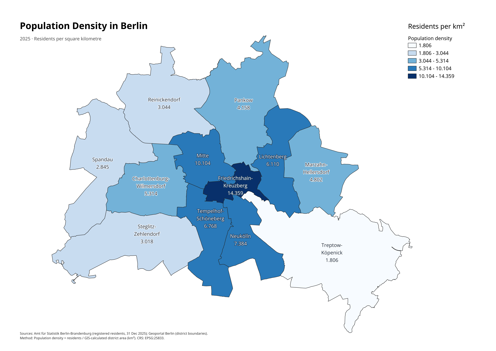
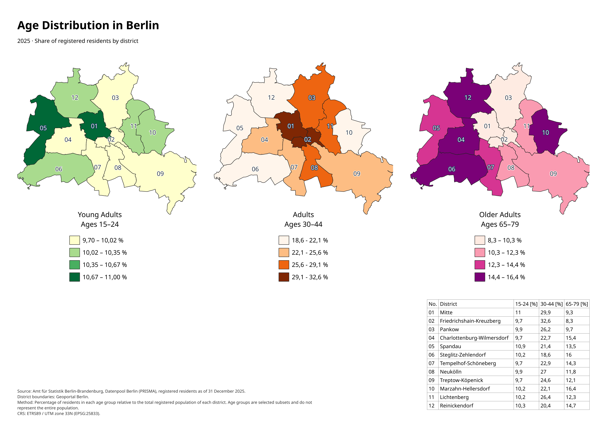
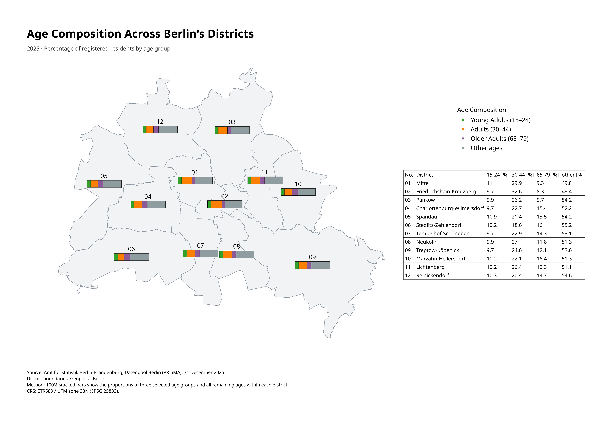

# Berlin Population & Demographics Atlas (2025)

A QGIS portfolio project exploring population density and age distribution across Berlin's 12 administrative districts (*Bezirke*), using official demographic statistics and geographic boundary data.

## Project Overview

The project investigates three questions:

1. Which Berlin districts have the highest population density?
2. How does the proportion of selected age groups differ between districts?
3. How can multiple demographic categories be compared on a single map?

All geographic analysis was performed in **QGIS**, primarily using its graphical interface.

## Final Maps

### 1. Population Density in Berlin



[View PDF map](outputs/maps/berlin_population_density_2025.pdf)

A choropleth map showing registered residents per square kilometre in each district.

Population density was calculated by dividing the total registered population by the GIS-calculated area of each district.

### 2. Age Distribution in Berlin



[View PDF map](outputs/maps/berlin_age_distribution_2025.pdf)

Three comparable thematic maps showing the percentage of residents belonging to the following age groups:

- **Young Adults:** 15–24 years
- **Adults:** 30–44 years
- **Older Adults:** 65–79 years

Each map uses a four-class graduated colour scale. A district comparison table provides exact percentages.

### 3. Age Composition Across Berlin's Districts



[View PDF map](outputs/maps/berlin_age_composition_2025.pdf)

A thematic map using 100% stacked bar diagrams to compare the demographic composition of each district.

Four categories are displayed:

- Young Adults (15–24)
- Adults (30–44)
- Older Adults (65–79)
- Other ages

The **Other ages** category includes all residents outside the three selected age groups. The four categories together represent 100% of each district's registered population.

## Data Sources

- **Population and age statistics:** Amt für Statistik Berlin-Brandenburg, Datenpool Berlin (PRISMA), registered residents at their main residence, 31 December 2025.
- **District boundaries:** Geoportal Berlin.

The demographic source is based on Berlin's residents register and is not identical to the official population projection or census-based population estimates.

## GIS Methodology

1. Import Berlin district boundaries and reproject them to EPSG:25833.
2. Store geographic boundaries in GeoPackage format.
3. Import demographic CSV data as an attribute-only table.
4. Aggregate population and age-group counts by district using QGIS Aggregate.
5. Join statistical records to district polygons using administrative district codes.
6. Calculate district area, population density, and age-group percentages using Field Calculator.
7. Create graduated choropleth maps with separate classification ranges.
8. Create 100% stacked bar diagrams for multivariate comparison.
9. Design A3 landscape maps using QGIS Print Layout, Map Themes, legends, and dynamic attribute tables.

## Coordinate Reference System

**EPSG:25833 — ETRS89 / UTM Zone 33N**

Projected coordinates are measured in metres. District areas were calculated using the projected geometries.

## Limitations

- The demographic figures represent registered residents as of 31 December 2025.
- Age categories are deliberately selected subsets of the population, not demographic generations.
- The original statistics include disclosure-control adjustments and some unavailable records.
- Calculated district areas may differ slightly from official administrative area statistics.
- Choropleth classification ranges are specific to each age-group map; identical colours or shades should not be interpreted as equivalent percentages across different maps.

## Project Structure

```text
data/
  raw/           Original downloaded sources (not tracked)
  processed/     Processed GeoPackage datasets

project/         QGIS project files

outputs/
  maps/          Final PDF and PNG maps
```

## Tools and Skills

**Software:** QGIS, LibreOffice Calc, Git, GitHub

**GIS techniques:** data cleaning, CRS transformation, spatial data management, attribute joins, aggregation, field expressions, thematic cartography, diagrams, and map layout design.

## Attribution

Demographic statistics: Amt für Statistik Berlin-Brandenburg, Datenpool Berlin (PRISMA). See the source documentation for the applicable CC BY attribution requirements.

District boundaries: Geoportal Berlin. Refer to the original dataset's licence and attribution information.